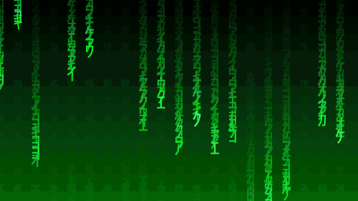
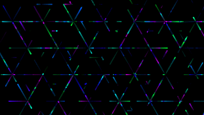
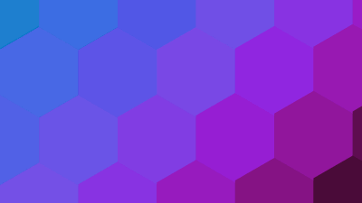
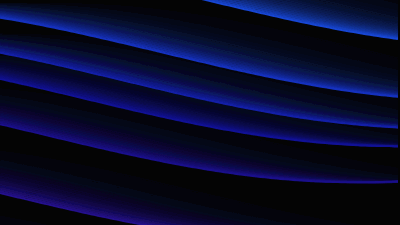
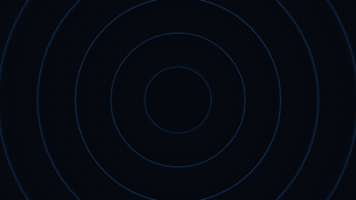
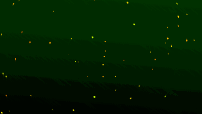

<p align="center">
  <a href="https://github.com/sponsors/niekes"></a>
</p>

<p align="center">
  <strong>Animated canvas backgrounds for the web, as drop-in web components.</strong><br>
  Free and open source, kept alive by one maintainer and the people who sponsor the work.
</p>

<p align="center">
  <a href="https://github.com/niekes/beautiful-backgrounds/actions/workflows/ci.yml"></a>
  <a href="https://github.com/niekes/beautiful-backgrounds/actions/workflows/ci.yml"></a>
  <a href="https://fallow.tools/docs/explanations/health/"></a>
  <a href="https://www.npmjs.com/package/beautiful-backgrounds"></a>
  <a href="https://www.npmjs.com/package/beautiful-backgrounds"></a>
  <a href="https://github.com/Niekes/beautiful-backgrounds/blob/main/LICENSE"></a>
  
  <a href="https://niekes.github.io/beautiful-backgrounds/"></a>
  <a href="https://github.com/niekes/beautiful-backgrounds"></a>
  <a href="https://github.com/sponsors/niekes"></a>
</p>

<p align="center">
  <a href="https://niekes.github.io/beautiful-backgrounds/">Storybook</a> ·
  <a href="#using-beautiful-backgrounds">Getting started</a> ·
  <a href="#backgrounds">Backgrounds</a> ·
  <a href="#sponsor-beautiful-backgrounds">Sponsor</a>
</p>

---

<table>
    <tr style="background-color: #f6f8fa">
        <td><a target="_blank" href="https://niekes.github.io/beautiful-backgrounds/?path=/story/backgrounds-ambient-ribbon--signature-flow"></a></td>
        <td><a target="_blank" href="https://niekes.github.io/beautiful-backgrounds/?path=/story/backgrounds-digital-rain--classic-matrix-rain"></a></td>
        <td><a target="_blank" href="https://niekes.github.io/beautiful-backgrounds/?path=/story/backgrounds-neon-rails--cyber-grid-network"></a></td>
    </tr>
    <tr style="background-color: #f6f8fa">
        <td><a target="_blank" href="https://niekes.github.io/beautiful-backgrounds/?path=/story/backgrounds-hexagon-wave--honeycomb-pulsar"></a></td>
        <td><a target="_blank" href="https://niekes.github.io/beautiful-backgrounds/?path=/story/backgrounds-liquid-lines--serpentine-flow"></a></td>
        <td><a target="_blank" href="https://niekes.github.io/beautiful-backgrounds/?path=/story/backgrounds-concentric-pulse--signature-pulse"></a></td>
    </tr>
    <tr style="background-color: #f6f8fa">
        <td><a target="_blank" href="https://niekes.github.io/beautiful-backgrounds/?path=/story/backgrounds-star-trail--galactic-vortex"></a></td>
        <td></td>
        <td></td>
    </tr>
</table>

Every background has live controls in the [Storybook](https://niekes.github.io/beautiful-backgrounds/).

## Sponsor beautiful-backgrounds

**beautiful-backgrounds** is free, and it always will be. There is no company behind it — just one maintainer working in spare time — so the cost of keeping it alive is paid for by the people who use it.

If a background made your site better, [become a sponsor](https://github.com/sponsors/niekes).

| Tier        | What you get                                                                                |
| ----------- | ------------------------------------------------------------------------------------------- |
| **$5/mo**   | Your name in the [sponsors list](#sponsors) and my sincere thanks                           |
| **$25/mo**  | The above, plus your logo in the README and in the Storybook, and priority issue triage     |
| **$100/mo** | The above, plus direct email access for feature requests and a mention in the release notes |

Where the money goes:

- **Issue triage and bug fixes.** Sponsorship buys a reply within a couple of days instead of whenever I get to it.
- **Backgrounds that keep running smoothly.** Testing across browsers and devices as Lit, the canvas APIs and the browsers move on.
- **The Storybook.** The live examples and controls for every background.
- **Time for new work.** More backgrounds, better performance on low-power devices, and more ways to configure them.

Prefer a one-off? The [sponsor page](https://github.com/sponsors/niekes) also takes one-time contributions.

**Need a company sponsorship or an invoice?** [Get in touch](mailto:s@niekes.com).

## Sponsors

Thank you to the people who make this possible. Sponsors at $25/mo and above get their logo in this README and in the Storybook; everyone gets their name below.

<!-- New sponsors go below this line, one per line. -->

## Using beautiful-backgrounds

```bash
npm install beautiful-backgrounds
```

Importing the package registers every background as a custom element:

```js
import "beautiful-backgrounds";
```

Or straight from a CDN, without a build step:

```html
<script type="module" src="https://esm.sh/beautiful-backgrounds"></script>
```

Then size an element like any other block, and set its attributes:

```html
<bb-star-trail
    bg-colors="#000010, #001040"
    particle-amount="800"
    style="width: 100%; height: 400px"
></bb-star-trail>
```

Each background fills its element, redraws at the new size when the window resizes, and pauses while the tab is hidden. Every attribute is listed with a live control in the [Storybook](https://niekes.github.io/beautiful-backgrounds/).

## Backgrounds

| Background                                                                                                                    | Element                 | Looks like                                                     |
| ----------------------------------------------------------------------------------------------------------------------------- | ----------------------- | -------------------------------------------------------------- |
| [Ambient Ribbon](https://niekes.github.io/beautiful-backgrounds/?path=/story/backgrounds-ambient-ribbon--signature-flow)      | `<bb-ambient-ribbon>`   | Flowing ribbons of light with control over waves and rotation  |
| [Concentric Pulse](https://niekes.github.io/beautiful-backgrounds/?path=/story/backgrounds-concentric-pulse--signature-pulse) | `<bb-concentric-pulse>` | Rings that breathe around the center while colors flow outward |
| [Digital Rain](https://niekes.github.io/beautiful-backgrounds/?path=/story/backgrounds-digital-rain--classic-matrix-rain)     | `<bb-digital-rain>`     | Matrix-style falling characters                                |
| [Hexagon Wave](https://niekes.github.io/beautiful-backgrounds/?path=/story/backgrounds-hexagon-wave--honeycomb-pulsar)        | `<bb-hexagon-wave>`     | A shaded grid of hexagons rolling like a wave                  |
| [Liquid Lines](https://niekes.github.io/beautiful-backgrounds/?path=/story/backgrounds-liquid-lines--serpentine-flow)         | `<bb-liquid-lines>`     | Undulating lines with a sense of depth                         |
| [Neon Rails](https://niekes.github.io/beautiful-backgrounds/?path=/story/backgrounds-neon-rails--cyber-grid-network)          | `<bb-neon-rails>`       | Particles racing along a geometric grid, leaving neon trails   |
| [Star Trail](https://niekes.github.io/beautiful-backgrounds/?path=/story/backgrounds-star-trail--galactic-vortex)             | `<bb-star-trail>`       | Orbiting stars with fading trails                              |

The source of each one lives in [`src/components`](src/components). To build your own, extend `BeautifulBackground` and implement its `loop()`.

## Star History

[](https://www.star-history.com/#niekes/beautiful-backgrounds&type=date&legend=bottom-right)
